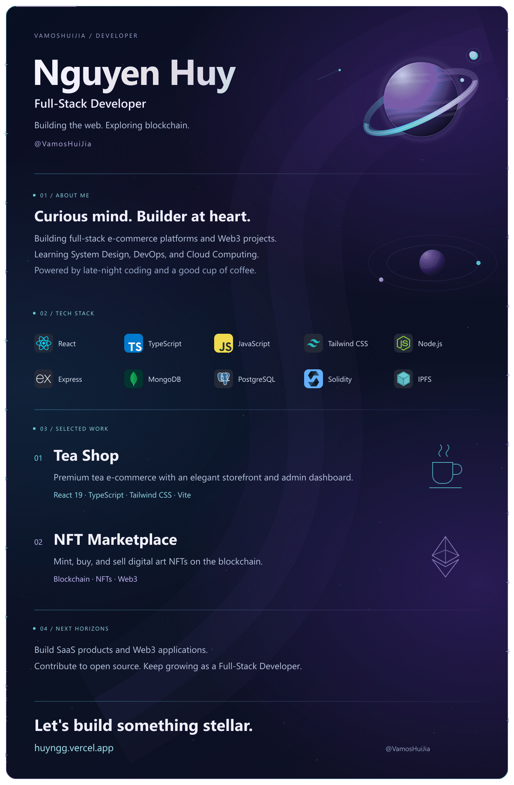
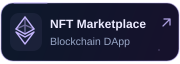

  <picture>
    <source media="(max-width: 600px) and (prefers-reduced-motion: reduce)" srcset="./assets/profile-cosmic-mobile.svg" />
    <source media="(prefers-reduced-motion: reduce)" srcset="./assets/profile-cosmic.svg" />
    <source media="(max-width: 600px)" srcset="./assets/profile-cosmic-mobile.gif" />
    
  </picture>

  
  
  
  

<strong>About &amp; projects</strong>

## Nguyen Huy · VamosHuiJia

**Full-Stack Developer · Web & Blockchain Enthusiast**

I build full-stack web applications and explore blockchain technology.

- **Building:** full-stack e-commerce platforms and Web3 projects.
- **Learning:** System Design, DevOps, and Cloud Computing.
- **After hours:** late-night coding and a good cup of coffee.

### Tech stack

React · TypeScript · JavaScript · Tailwind CSS · Node.js · Express · MongoDB · PostgreSQL · Solidity · IPFS

### Selected work

**[Tea Shop](https://github.com/VamosHuiJia/project.teashop-frontend)** — Premium tea e-commerce with an elegant storefront, admin dashboard, responsive layouts, and smooth animations. Built with React 19, TypeScript, Tailwind CSS, and Vite.

**[NFT Marketplace](https://github.com/VamosHuiJia/project.blockchain-marketplace)** — A blockchain DApp for minting, buying, and selling digital art NFTs.

### Next horizons

- Build SaaS products and Web3 applications.
- Contribute to open source.
- Keep growing as a Full-Stack Developer.

[Portfolio](https://huyngg.vercel.app/) · [All repositories](https://github.com/VamosHuiJia?tab=repositories) · [GitHub activity](https://github.com/VamosHuiJia?tab=overview)

