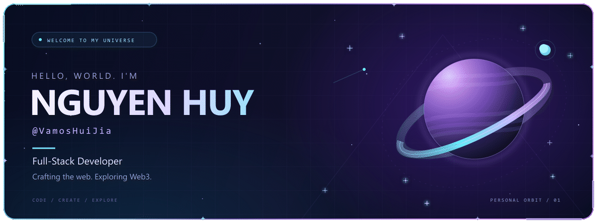
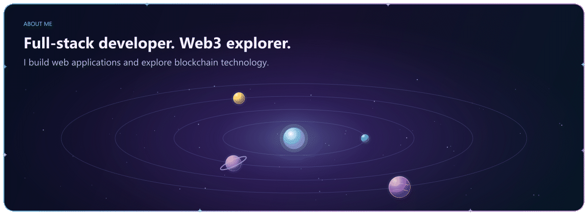
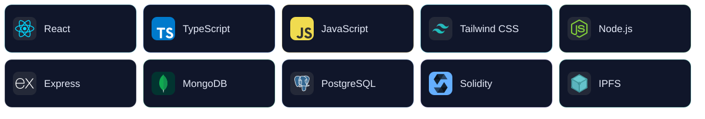
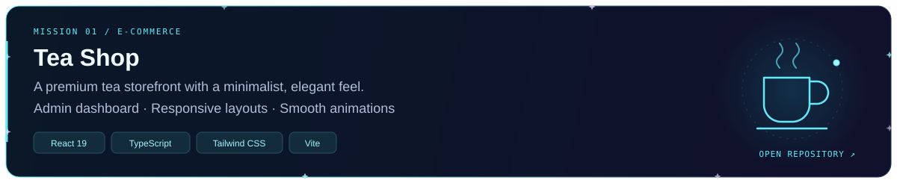
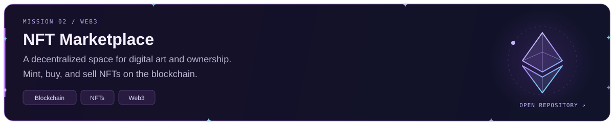
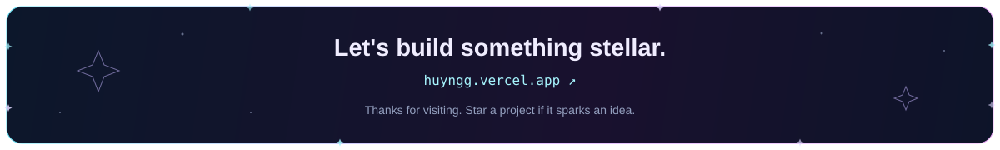

<picture>
  <source media="(max-width: 600px) and (prefers-reduced-motion: reduce)" srcset="./assets/cosmic-header-mobile.svg" />
  <source media="(prefers-reduced-motion: reduce)" srcset="./assets/cosmic-header.svg" />
  <source media="(max-width: 600px)" srcset="./assets/cosmic-header-mobile.gif" />
  
</picture>

# Hey, I'm Nguyen Huy 👋

**Full-Stack Developer · Web & Blockchain Enthusiast**

Building thoughtful interfaces, full-stack products, and new possibilities on the web.

&nbsp;

<picture>
  <source media="(max-width: 600px) and (prefers-reduced-motion: reduce)" srcset="./assets/cosmic-overview-mobile.svg" />
  <source media="(prefers-reduced-motion: reduce)" srcset="./assets/cosmic-overview.svg" />
  <source media="(max-width: 600px)" srcset="./assets/cosmic-overview-mobile.gif" />
  
</picture>

## 🛰️ Mission log

- **Building:** full-stack e-commerce platforms and Web3 projects.
- **Exploring:** System Design, DevOps, and Cloud Computing.
- **Driven by:** beautiful interfaces and useful, real-world products.
- **After hours:** late-night coding, a good cup of coffee, and one more idea to try.

## 🧬 Technology arsenal

  <picture>
    <source media="(max-width: 600px)" srcset="./assets/tech-stack-mobile.svg" />
    
  </picture>

  From the interface to the API — and out into Web3.

## 🪐 Featured missions

<a href="https://github.com/VamosHuiJia/project.teashop-frontend">
  <picture>
    <source media="(max-width: 600px)" srcset="./assets/project-teashop-mobile.svg" />
    
  </picture>
</a>

<a href="https://github.com/VamosHuiJia/project.blockchain-marketplace">
  <picture>
    <source media="(max-width: 600px)" srcset="./assets/project-nft-mobile.svg" />
    
  </picture>
</a>

  <a href="https://github.com/VamosHuiJia?tab=repositories"><strong>Explore all repositories ↗</strong></a>

## 🔭 Next horizons

- Turn more ideas into **SaaS products** and **Web3 applications**.
- Contribute to **open source** and learn alongside other developers.
- Keep growing as a **Full-Stack Developer**, from architecture to deployment.

  
<strong>📡 GitHub activity signals</strong>

  
Follow the activity behind the projects:

  <ul>
    <li><a href="https://github.com/VamosHuiJia?tab=overview">Contribution graph on GitHub ↗</a></li>
    <li><a href="https://streak-stats.demolab.com/?user=VamosHuiJia&amp;theme=tokyonight&amp;hide_border=true">Live contribution streak ↗</a></li>
  </ul>

 

  <a href="https://huyngg.vercel.app/">
    <picture>
      <source media="(max-width: 600px)" srcset="./assets/cosmic-footer-mobile.svg" />
      
    </picture>
  </a>

